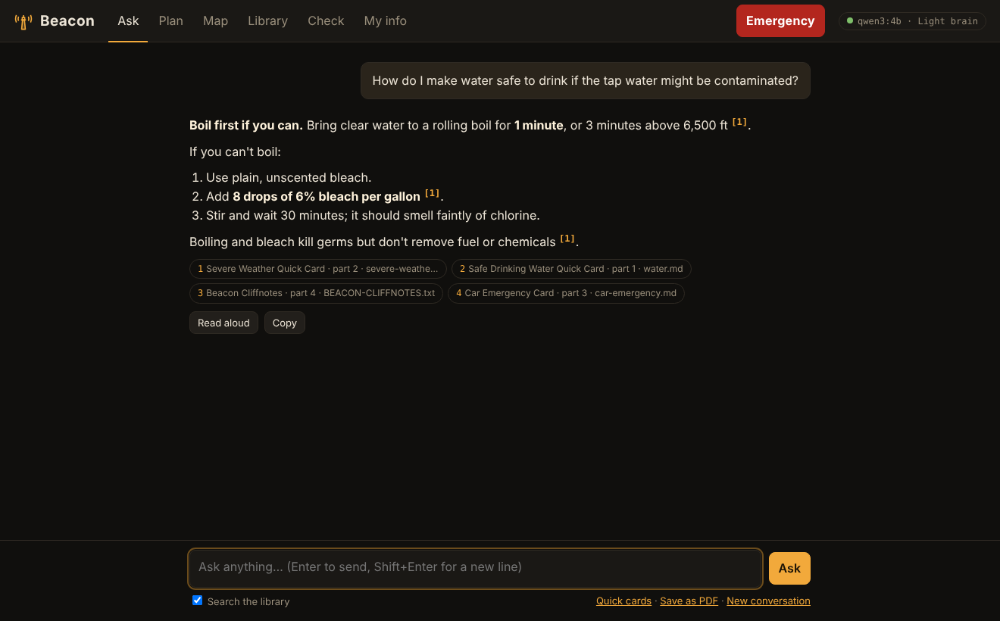
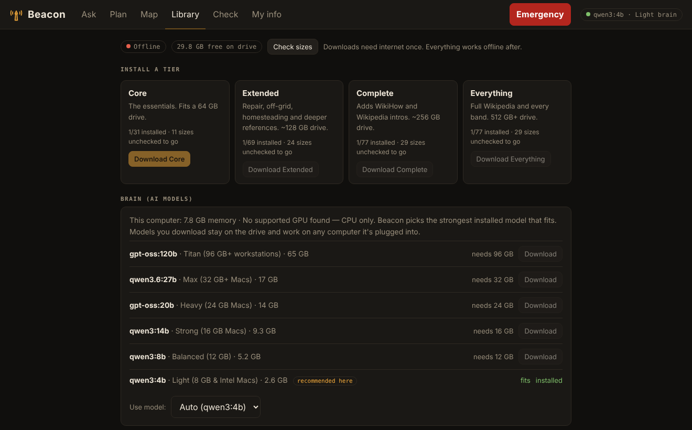

# Beacon

**An offline survival guide, library and AI assistant on a USB drive.** Plug it into a Mac or Windows PC, double-click, and ask anything: first aid, water, storms, power outages, food, maps, radio, evacuation. A private AI answers from a library of survival manuals, offline encyclopedias and quick-reference cards, and shows the exact page it used. No internet, no accounts, nothing leaves the drive.



| | |
|---|---|
|  |  |
|  |  |

## What it does

- **Ask**: plain-English questions, answered from the library on the drive, with clickable citations. **Read aloud** and **Save as PDF** on every answer.
- **Emergency button**: instant first-aid, weather, water, car, radio and signal cards. No AI, no waiting.
- **Plan**: 13 printable plan templates (evacuation, leaving the country, shelter in place, winter storm, tornado, heat wave, hurricane, get-home, 30-day food, garden, wilderness, home security, mind and body). They're filled in from your library, your location and your household info.
- **Map**: offline world map plus a detailed map of your region. Search 60,000+ towns worldwide or type coordinates. Shows straight-line distance, compass heading, walking, driving or flight time, and the nearest towns. Uses device location if available, otherwise manual entry. Prints to PDF.
- **Library**: install content by **tier** (Core → Extended → Complete → Everything) or pick individual items from **14 topic bands**. Search the whole Kiwix catalog for anything else.
- **Brain that fits the machine**: on startup Beacon checks memory, graphics, disk and battery, then runs the strongest model that computer can handle. Stronger machines also get a longer context window and more sources per answer.
- **Check**: proves the AI engine answers and that every manual and library on the drive is actually findable by search. Flags scanned PDFs that can't be read.
- **My info**: household members, medical needs, contacts and meeting places. Plans use it automatically.
- **Binder**: one click prints every quick card, the cliff notes and your household info as a paper backup.
- **Reading shelf**: adventure classics, true survival stories, Stoic philosophy and spiritual texts, in a clean reader.
- **Plain-text fallback**: [`START-HERE.txt`](START-HERE.txt) and [`BEACON-CLIFFNOTES.txt`](library/manuals/cards/BEACON-CLIFFNOTES.txt) work on any device even if nothing else does.

## What's in the library

Everything is downloaded from the original publisher by the builder; nothing copyrighted is stored in this repo. Full list with sources: [`catalog.json`](catalog.json).

| Band | Highlights |
|---|---|
| Medical & First Aid | WikiMed, field medicine collection, Army Combat Lifesaver course, WikEM, MedlinePlus; links to *Where There Is No Doctor* and *Emergency War Surgery* |
| Water, Food & Foraging | Water and food-preparation collections, FAO fermentation guide, Missouri edible and poisonous mushrooms, cooking Q&A |
| Shelter, Fire & Winter | Post-disaster guides, Beard, Nessmuk, Kephart woodcraft classics, Army cold-region operations |
| Wilderness, Navigation & Nature Signs | Army Survival (ATP 3-50.21, FM 3-05.70), Map Reading & Land Navigation, Visual Signals, knots, outdoors Q&A |
| Weather, Disasters & Civil Defense | FEMA *Are You Ready?*, *Nuclear War Survival Skills*, NWS spotter guide, Ready.gov, CDC, Wikivoyage |
| Radio, Signals & Morse | Ham radio Q&A, Army field radio and improvised antennas (FM 24-18) |
| Security, Self-Defense & Evasion | Survival, Evasion & Recovery (FM 3-50.3), Air Force SERE handbook, Ranger Handbook, Combatives, Camouflage |
| Hunting, Fishing, Trapping & Firearms | *Deadfalls and Snares*, *Hunting with the Bow and Arrow*, Army rifle marksmanship and safety |
| Growing Food & Homesteading | Gardening Q&A, Appropedia |
| Vehicles, Repair & Tools | Vehicle repair Q&A, iFixit, home repair, electronics |
| Power & Off-Grid Living | Energypedia, sustainable living Q&A |
| Mind, Body & Discipline | Army Holistic Health & Fitness (FM 7-22), fitness Q&A, *Meditations*, *Enchiridion* |
| Reading Shelf | *South* (Shackleton), *Robinson Crusoe*, *The Mysterious Island*, *Monte Cristo*, *Art of War*, Bible, Bhagavad Gita, Tao Te Ching, Dhammapada, Qur'an, and more |
| Wikipedia & General Knowledge | Medicine subset → top articles → Wikibooks → WikiHow → all of Wikipedia (mini, no-pictures or full) |

Plus **13 quick-reference cards** written for Beacon (first aid, water, severe weather, power outage, car, radio, Morse and signals, navigation, evacuation and leaving the country, low profile and personal safety, wild food and game, firearms and archery safety, mind and body), and the cliff notes.

## Requirements

- **Mac**: macOS 14 Sonoma or newer, on Apple Silicon (fast) or Intel (slower, CPU only). This is the current Ollama minimum.
- **Windows**: Windows 10 or 11, 64-bit. An NVIDIA GPU makes answers much faster.
- **Memory**: 8 GB works with the light brain; **16 GB or more** recommended.
- **USB drive**: exFAT format (works on Mac and Windows). 64 GB for Core, 128 GB for Extended, 256 GB for Complete, 512 GB+ for Everything. A fast USB 3 / USB-C drive helps a lot.

| Brain | Memory needed | Download |
|---|---|---|
| qwen3:4b (Light) | any | 2.6 GB |
| qwen3:8b (Balanced) | 12 GB | 5.2 GB |
| qwen3:14b (Strong) | 16 GB | 9.3 GB |
| gpt-oss:20b (Heavy) | 24 GB | 14 GB |
| qwen3.6:27b (Max) | 32 GB | 17 GB |
| gpt-oss:120b (Titan) | 96 GB | 65 GB |

The builder installs Light + Strong by default; add others from the Library tab. Edit tiers in [`beacon/models.py`](beacon/models.py).

## Build a drive (once, on a Mac with internet)

1. Format the USB drive in Disk Utility as **exFAT** and name it `BEACON`.
2. Run:
   ```bash
   git clone https://github.com/<you>/beacon.git && cd beacon
   ./scripts/build_usb.sh /Volumes/BEACON
   ```
   It asks which tier you want and which town to make a detailed map of. Or pass options:
   ```bash
   ./scripts/build_usb.sh /Volumes/BEACON --tier extended --region "Atlanta" --radius 300
   ./scripts/build_usb.sh /Volumes/BEACON --models "qwen3:4b qwen3:14b qwen3.6:27b" --no-windows
   ```
   Re-run any time to resume or refresh. The drive gets portable Python for Mac (both chip types) and Windows, the Ollama engine for both, the AI models, the library, maps, and the search index.
3. Add your own PDFs to `Beacon/library/manuals/` and click **Index manuals folder** in the app.

## Use it (no internet)

- **Mac**: open the drive → `Beacon` → right-click `Beacon.command` → **Open** (first time only), then double-click from then on.
- **Windows**: open the drive → `Beacon` → double-click `Beacon.bat` (if SmartScreen appears: **More info** → **Run anyway**).

Everything a non-technical person needs is in [`START-HERE.txt`](START-HERE.txt), which the builder also puts at the top of the drive.

## Honest limits

- **The AI can be wrong.** It's instructed to answer from the library, cite it, say when it's guessing, and never confirm a wild plant or mushroom is safe from a description. For medical, electrical, gas, weapons or wild-food decisions, **open the citation and read the source**, and call emergency services whenever you can.
- **No live information.** Offline, Beacon can't know today's weather, road closures or where it's dangerous right now. It reasons from what's on the drive and what you tell it.
- **No turn-by-turn directions** yet. Maps show where you are, where you're going, distance, heading and the terrain in between.
- **Laptops have no GPS.** "Use device location" works only when the computer can get a fix (Wi-Fi positioning needs internet; or plug in a USB GPS). Manual entry always works.
- **Battery**: a laptop draws roughly 30–60 W while the AI writes. The Emergency cards and binder use almost nothing.
- **Personal info** in My info is stored on the drive unencrypted.

## Develop

```bash
pip install -r requirements.txt pytest       # Python 3.10+
ollama pull qwen3:4b && ollama pull nomic-embed-text
python -m beacon                             # http://127.0.0.1:8642
python -m pytest -q                          # 34 tests; AI engine and internet are faked
python -m beacon.installer --list            # everything the library can install
```

```
beacon/
  app.py          web server and API          library.py   catalog, Kiwix lookups, downloads
  rag.py          retrieval + prompts          manuals.py   PDF/text index (embeddings + keywords)
  kiwix_source.py offline encyclopedias       places.py    offline place search + navigation math
  models.py       brain tiers and profiles     mapdata.py   GeoNames + Protomaps map building
  system.py       startup resource check       plans.py     plan templates
  checks.py       library check                installer.py command-line installer
static/index.html the whole interface (no internet: map library, fonts and icons are bundled)
```

## Credits and licenses

Code: MIT. Bundled map viewer: MapLibre GL JS, PMTiles and Protomaps basemaps (BSD-3), world-atlas and topojson-client (ISC), Noto Sans fonts (OFL). Downloaded content keeps its own license: Kiwix archives (mostly CC BY-SA), OpenStreetMap data via Protomaps (ODbL), GeoNames (CC BY 4.0), US government publications (public domain), Project Gutenberg texts (public domain in the US). Publishers who ask for downloads from their own site (Hesperian, Borden Institute, NCHFP) are linked, not mirrored.

## Roadmap

- Offline turn-by-turn routing for the home region
- Share Beacon to phones on a local Wi-Fi network
- Photo questions with a vision model (never for confirming edible plants)
- Text recognition (OCR) for scanned PDFs
- Linux launcher
