# Beacon

**An offline survival guide, library and private AI that runs from a USB drive on any Mac.** Plug it in, double-click, and ask anything: first aid, water, storms, power outages, food, farming, maps, radio, evacuation. A local AI answers from a library of survival manuals, offline encyclopedias and quick-reference cards, and shows the exact page it used. Tell it what you're facing and what you have, and it lays out what to do first and how to make do without what's missing. Turn on sharing and every phone on the Wi-Fi can use it too, through the Mac's own AI. No internet, no accounts, nothing leaves the room.

It's built for the whole range: a two-day power outage, a winter storm, a long stretch off the grid, being stranded on a coast, or leaving a dangerous place quietly.

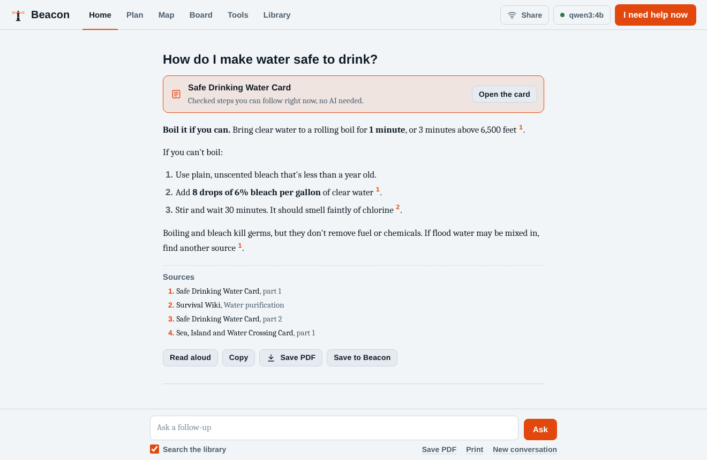

## What it does

**Your next steps.** A few setup questions: when this is for (preparing ahead, happening now, recovering after), what you're facing, who's with you, where you are, and what you have, from "almost nothing yet" to a power station, a generator and radios. Beacon answers with what to do first, what each thing you have is good for, what's missing in order of importance, and how to make do until you have it, each step one tap from the card, plan or tool that covers it. The rules are plain and tested, so this works instantly with the AI off. The AI then fits every answer to your situation.

**In an emergency.** "I need help now" opens 26 quick cards instantly, with no AI and no waiting: first aid, weather, water, fire, power outage, car, make do, evacuate, perimeter, evade, self-defense, navigation, sea and island, signals, satellite and car, radio, sanitation, radiation and chemical, off-grid power, grow food, wild food, community, mesh radio, phone safety, firearms, mind and body, plus the cliff notes. A CPR metronome, a tourniquet timer and a flashlight with SOS are one tap away.

**Ask.** Plain-English questions, answered from what's on the drive, with numbered citations that open the original page. Read aloud, copy, save as a PDF, or keep it on the drive.

**Plan.** Eighteen printable plans: evacuation, leaving the country, shelter in place, winter storm, tornado, heat wave, hurricane or flood, get home, 30 days of food and water, food garden, homestead, wilderness, stranded on an island or coast, defensive perimeter, survive and evade, neighborhood network, backup power, and mind and body. Each one asks when it's for and is filled in from your setup answers, your household, your location and your library. Plans are kept on the drive and open with the AI off.

**Map.** Offline world and regional maps, 60,000+ places, coordinates, distance, compass heading, walking, driving and flying time, nearest towns, and positions from mesh radios. A mesh radio with GPS gives the Mac its location.

**Board.** A message board for everyone on this Beacon: a check-in roster (safe or needs help), needs, offers and reports, with pins and moderation from the Beacon computer.

**Mesh radio and linked Beacons (optional).** Plug in a Meshtastic radio and Beacon connects to it by itself: messages heard over the air land on the Board, posts go out over the air, and anyone with a radio can check in by sending `SAFE The Garcias` or `HELP Unit 4B: out of insulin`. A second Beacon on the same network can link to the first with its code, so both share one Board: a house, a shelter and a fire hall, each with its own Beacon, see the same check-ins.

**Tools.** CPR metronome, tourniquet timer, rehydration drink, water treatment with bleach, water to store, power budget for batteries and solar, supplies tracker, Morse code, radio channels with a MAYDAY call builder, flashlight and SOS, heat and cold risk, lightning distance, sun and moon times, translate, unit conversions.

**Share with phones.** Turn on Wi-Fi sharing and anyone on the same network opens `beacon.local`, scans a QR code or types a 4-digit code, and uses Beacon in their browser, powered by the Mac's AI. Guests can ask, plan, read, check in and save files to their phone. Their setup answers stay on their own phone. They can't change anything.

**Connections monitor.** Shows every signed-in device and linked Beacon, every wrong code, lockout and blocked request, with macOS alerts, a sign-out button per device and a CSV log for reports. See [SECURITY.md](SECURITY.md).

**Updates when online (optional).** Off until you turn it on. When the Mac has internet, Beacon checks official weather alerts for your area, disaster alerts, significant earthquakes, travel advisories and headlines, and keeps them on the drive so phones and the AI can read them offline. Local warnings show as a banner on Home.

**Library.** Install by tier (Core, Extended, Complete, Everything) or pick from 15 topics; search the whole Kiwix catalog; every download is checked. Your next steps suggests the manuals that fit your situation. A health check proves the AI answers and that every manual and library on the drive can actually be found. Paper backups: a printable binder, every card as plain text for phones, and the cliff notes.

**A brain that fits the machine.** On startup Beacon checks memory, graphics and battery, then runs the strongest model that Mac can handle. Low power mode turns the AI off while cards, tools, maps and the library keep working.

| | |
|---|---|
| 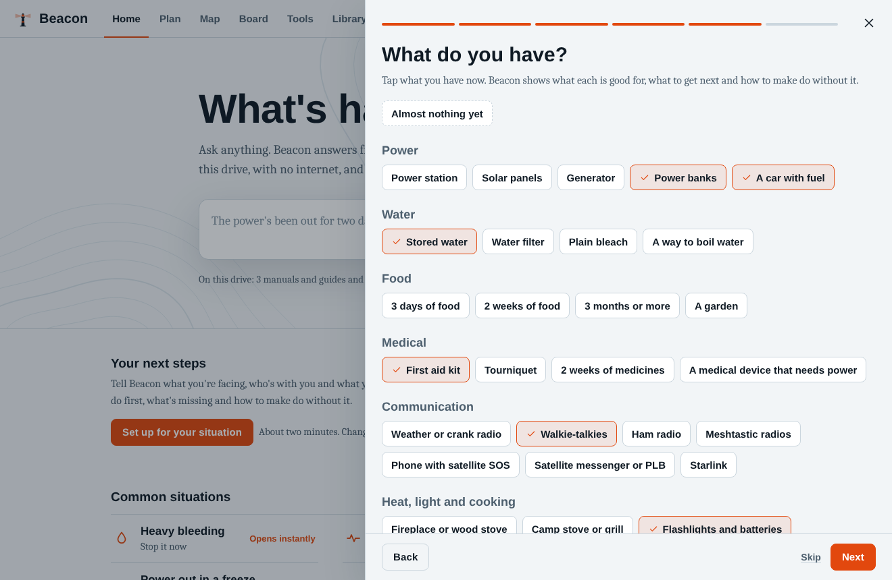 | 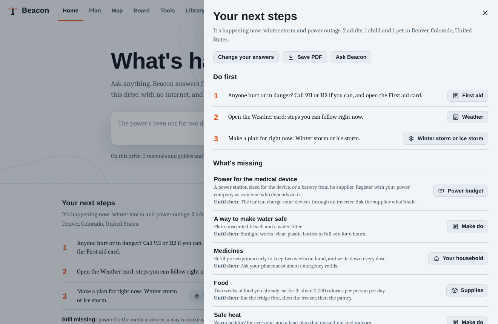 |
| 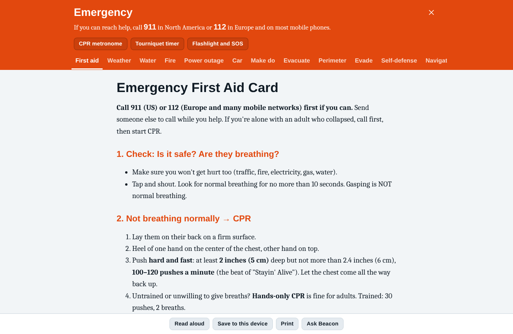 | 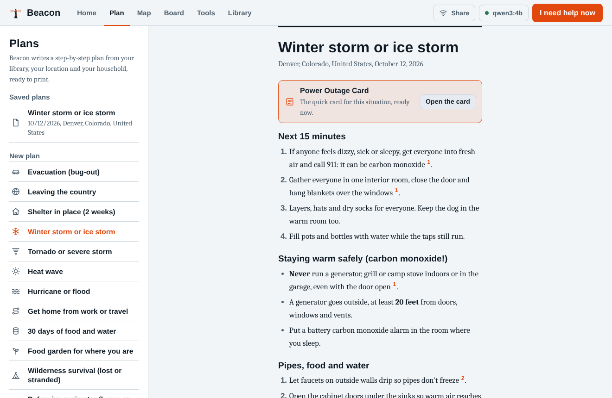 |
| 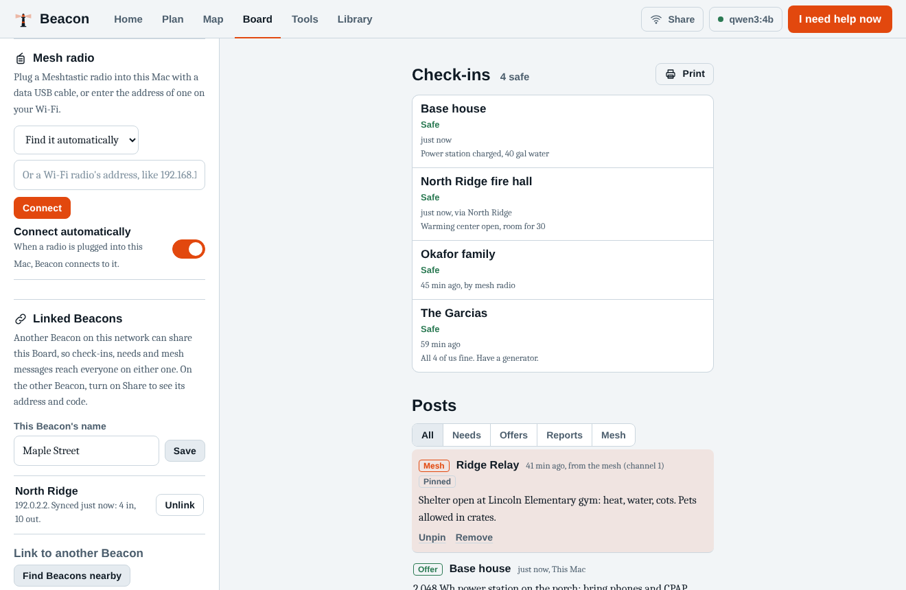 | 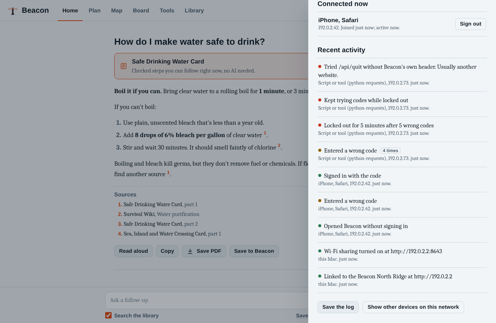 |
| 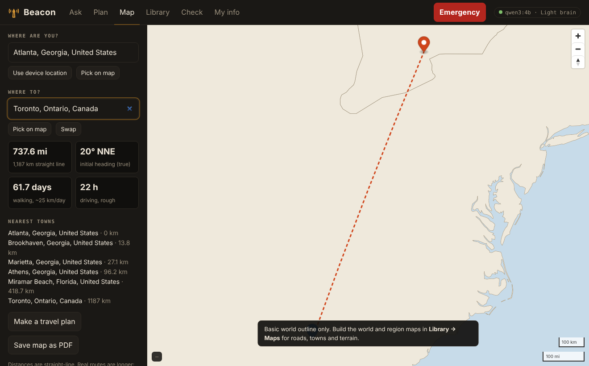 | 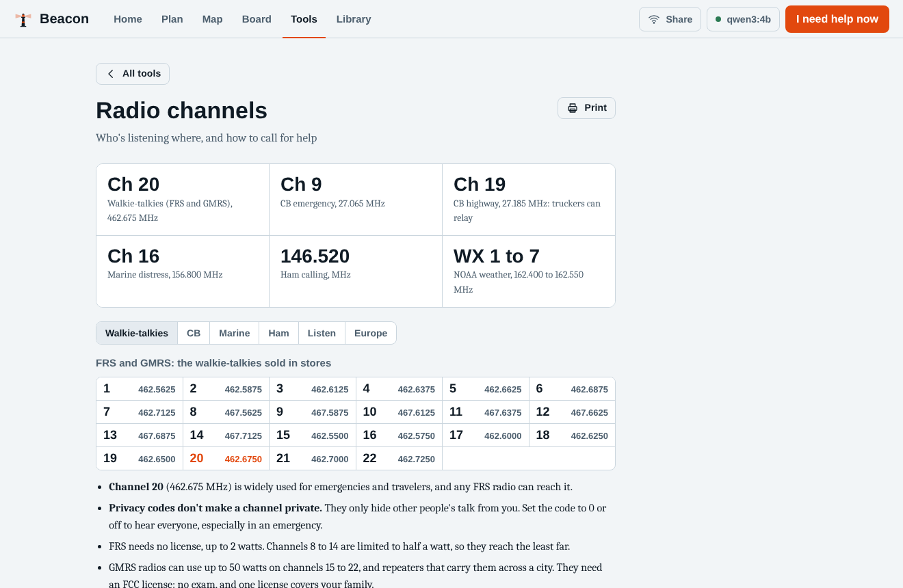 |

<p>
  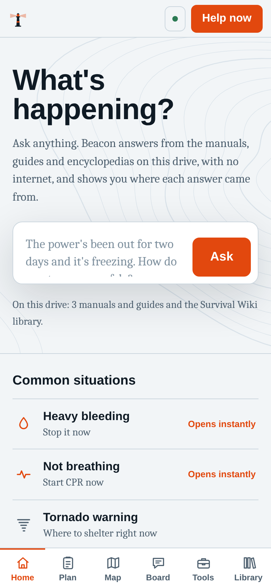
  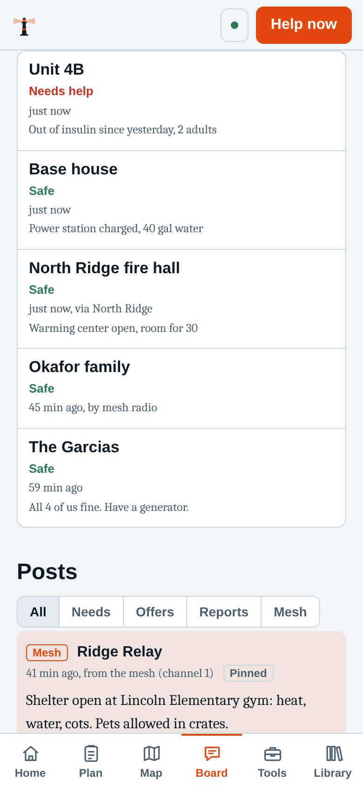
  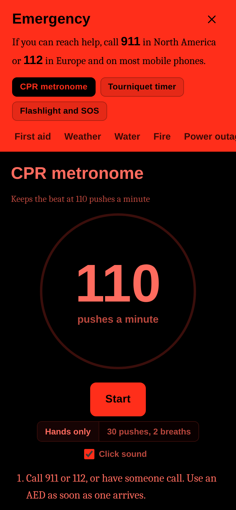
</p>

## How it works

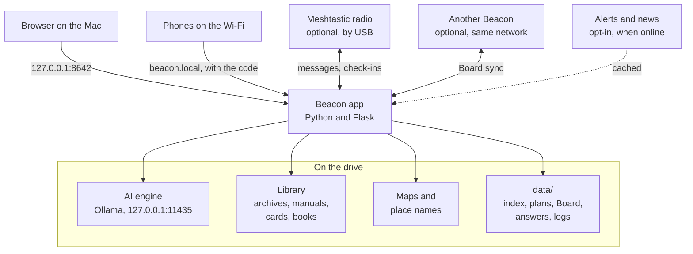

One small Python program on the drive serves the interface to the browser and answers through an AI engine that also runs from the drive. A question goes through one guard (known host name, Beacon's own header, guest rules), then retrieval: full-text search in the offline encyclopedias and a meaning-and-keyword search of the manuals, trimmed to what this Mac's brain can read. The AI gets short rules, the numbered sources, and two optional notes: who's asking (from the setup answers) and current updates. It streams the answer back with citations, and the matching quick card is offered first, so there's always a vetted answer with no AI at all.

Beacon is modular by design: cards, plans, tools, library items, update feeds, brains and setup answers are each a list entry in one file, picked up everywhere they're used. **[docs/ARCHITECTURE.md](docs/ARCHITECTURE.md)** walks through the request path, sharing, the Board, mesh and linked Beacons, where data lives, and how to extend each part.

## Security

Beacon is designed to be safe to run on a shared network by people who aren't technical. Highlights:

- **Private by default.** Beacon and its AI engine listen only on `127.0.0.1`; the health check proves it by connecting from the network side and expecting a refusal.
- **Sharing is opt-in.** A 4-digit code buys a random 192-bit session; wrong codes are rate limited per device and the code changes itself under attack. Guests can't change settings, download, see household info or setup answers, link Beacons or quit.
- **Your answers stay yours.** The Beacon computer's setup answers and household info never reach guests. A guest's answers stay on their phone and are never stored.
- **Nothing leaves without a person choosing it.** Updates are off by default and send nothing about you; a linked Beacon shares only the Board.
- **Transparent.** A live connections monitor with alerts, a per-device sign-out and an exportable log that never records questions or answers.
- **Hardened against other websites and hostile content.** Host-name allowlist (DNS rebinding), a required request header (CSRF), a strict Content-Security-Policy with no inline scripts, sandboxed library pages, and feeds parsed as data with entity declarations refused.
- **Verified supply chain.** Publisher checksums for Python, Ollama and every Kiwix download; hash-locked Python packages; a pinned map tool; a software bill of materials on every drive.
- **Honest about trade-offs.** Plain HTTP on the local network, a short code and a development-grade web server are documented as accepted risks, with mitigations.

Threat model, every control with the test that proves it, and how to check it yourself: **[SECURITY.md](SECURITY.md)**.

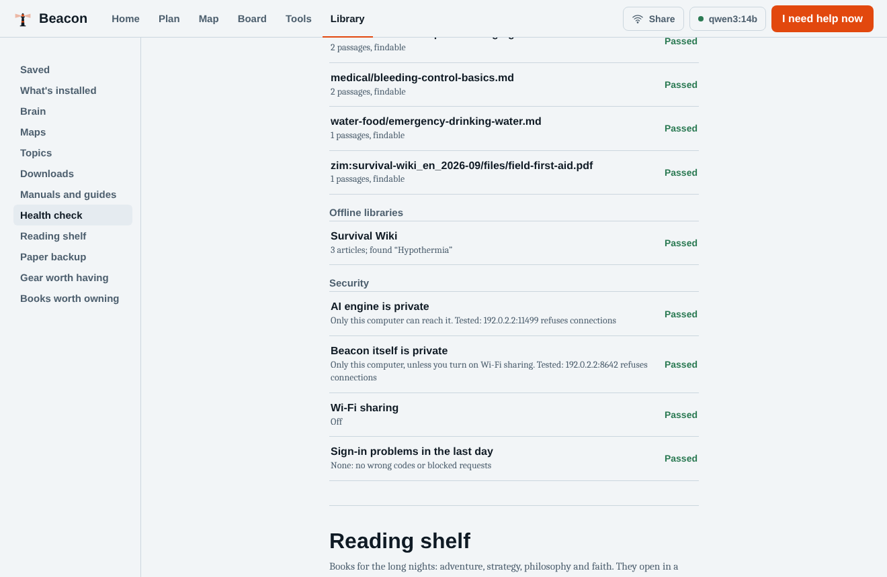

## What's in the library

Everything is downloaded from the original publisher by the builder; nothing copyrighted is stored in this repo. Full list with sources: [`catalog.json`](catalog.json).

| Topic | Highlights |
|---|---|
| Medical and first aid | WikiMed, field medicine collection, Army first aid (ATP 4-02.11), Stop the Bleed, Combat Lifesaver course, WikEM, MedlinePlus, CDC snakebite, FDA insulin storage; links to *Where There Is No Doctor* and *Emergency War Surgery* |
| Water, food and foraging | Water and food-preparation collections, EPA and CDC disinfection, food safety in an outage, FAO fermentation, Missouri mushrooms, USDA canning |
| Shelter, fire and winter | Post-disaster guides, Beard, Nessmuk and Kephart woodcraft classics, Army cold-region and mountain manuals |
| Wilderness, navigation and nature signs | Army Survival (ATP 3-50.21, FM 3-05.70) with sea survival, land navigation, visual signals, knots, outdoors Q&A |
| Weather, disasters and civil defense | FEMA *Are You Ready?*, *Nuclear War Survival Skills*, Sweden's *In Case of Crisis or War*, Finland and Czech 72-hour guides, State Department crisis guidance, NWS spotter guide, CDC radiation guidance, Ready.gov, Wikivoyage |
| Radio, mesh, signals and community | FEMA CERT basic training manual, Meshtastic setup, channels and recommended settings, ham radio Q&A, Army field radio and improvised antennas |
| Security, self-defense and evasion | Survival, Evasion and Recovery (FM 3-50.3), Air Force SERE handbook, Ranger Handbook, combatives, camouflage, EFF guide to phones at borders |
| Hunting, fishing, trapping and firearms | *Deadfalls and Snares*, *Hunting with the Bow and Arrow*, Army rifle marksmanship and safety, hunter education |
| Growing food and homesteading | Gardening Q&A, Appropedia, the Texas rainwater harvesting manual, Peace Corps small-scale irrigation |
| Vehicles, repair and tools | Vehicle repair Q&A, iFixit, home repair, electronics |
| Power and off-grid living | Energypedia (solar, batteries, small hydro, generators), sustainable living Q&A |
| Mind, body and discipline | Army Holistic Health and Fitness (FM 7-22), Psychological First Aid (NCTSN and WHO), *Meditations*, *Enchiridion*, *Walden* |
| Reading shelf | *South*, *Robinson Crusoe*, *The Mysterious Island*, *Monte Cristo*, *The Art of War*, the Bible, Bhagavad Gita, Tao Te Ching, Dhammapada, Qur'an and more |
| Learning and schooling | PhET simulations, Wikiversity, Khan Academy |
| Wikipedia and general knowledge | Medicine subset, top articles, Wikibooks, WikiHow, all of Wikipedia (intros, no pictures, or full) |

Plus **26 quick-reference cards** written for Beacon and the cliff notes, a gear list (power stations and solar, NOAA and crank radios, Meshtastic radios, FRS and GMRS walkie-talkies, water filters, tourniquets and more) and the survival books worth owning in print.

## Requirements

- **A Mac with macOS 14 Sonoma or newer.** Apple Silicon is fast; Intel Macs work but run on the CPU, so answers are slow. (Windows is planned: see [`platforms/windows`](platforms/windows).)
- **Memory:** 8 GB works with the light brain; 16 GB or more is recommended.
- **Drive:** a portable SSD is much faster than a thumb drive for loading the AI. APFS format is best (and can be encrypted).

| Library tier | Drive size | Adds |
|---|---|---|
| Core | 64 GB | The essentials |
| Extended | 128 GB | Repair, off-grid, homesteading, books |
| Complete | 256 GB | WikiHow, Wikipedia intros, learning |
| Everything | 512 GB+ | All of Wikipedia (1 TB recommended) |

**Recommended: a 1 TB USB-C SSD** (Samsung T7 Shield, SanDisk Extreme, Crucial X9/X10). It holds everything, bigger brains and your own files. The Library tab shows exact sizes before downloading.

| Brain | Memory needed | Download |
|---|---|---|
| qwen3:4b (Light) | any | 2.6 GB |
| qwen3:8b (Balanced) | 12 GB | 5.2 GB |
| qwen3:14b (Strong) | 16 GB | 9.3 GB |
| gpt-oss:20b (Heavy) | 24 GB | 14 GB |
| qwen3.6:27b (Max) | 32 GB | 17 GB |
| gpt-oss:120b (Titan) | 96 GB | 65 GB |

The builder installs Light and Strong by default; add others from the Library tab. Tiers live in [`beacon/models.py`](beacon/models.py).

## Build a drive (once, on a Mac with internet)

1. In Disk Utility, erase the drive as **APFS (Encrypted)** and name it `BEACON`. (exFAT also works, but can't be encrypted.)
2. Get Beacon and run the builder in Terminal. With git:
   ```bash
   git clone https://github.com/titomazzetta/beacon.git && cd beacon
   ./scripts/build_usb.sh /Volumes/BEACON
   ```
   No git? Click **Code → Download ZIP** at the top of this page and unzip it in Downloads (Safari does that for you), then:
   ```bash
   cd ~/Downloads/beacon-main && bash scripts/build_usb.sh /Volumes/BEACON
   ```
   It asks which tier and which town to map in detail. Or pass options:
   ```bash
   ./scripts/build_usb.sh /Volumes/BEACON --tier extended --region "Denver" --radius 300
   ./scripts/build_usb.sh /Volumes/BEACON --models "qwen3:4b qwen3:14b qwen3.6:27b"
   ./scripts/build_usb.sh /Volumes/BEACON --no-mesh      # leave out the Meshtastic add-on
   ```
   Re-run any time to resume or refresh. The builder verifies every program against its publisher's checksum (or a pinned hash) before using it, installs Python packages from a hash lock, checks that the AI answers from the drive, and writes a software list with hashes to `Beacon/data/SBOM.txt`.
3. Add your own PDFs to `Beacon/library/manuals/` and click **Index new files** in the Library tab.

## Use it

Open the drive, then the `Beacon` folder, and double-click **Beacon**. It opens in your browser; the first start takes a minute or two while the AI loads, then offers the setup questions. Use **Quit** (status button, top right) before ejecting.

[`START-HERE.txt`](START-HERE.txt), which the builder also puts at the top of the drive, covers everything for a non-technical person, including a **15-minute first-run checklist**: answer the setup questions, run the health check, lock the drive, fill in your household, make and save one plan, and test sharing from your phone.

## Honest limits

- **The AI can be wrong.** It's told to answer from the library, cite it, say when it's guessing, and never confirm a wild plant or mushroom is safe from a description. For medical, electrical, gas, weapons or wild-food decisions, open the citation and read the source, and call emergency services whenever you can.
- **Offline means no live information.** Without internet, Beacon can't know today's weather, road closures or where it's dangerous right now; it reasons from the drive and from what you tell it. With updates on, alerts and headlines are only as fresh as the last time the Mac was online, and the feeds themselves can be late or incomplete.
- **No turn-by-turn directions** yet: straight-line distance, heading and travel-time estimates only.
- **Location:** Macs have no GPS, and phones only share location with secure (HTTPS) pages, which Beacon's local network sharing isn't. Type a town or coordinates, or plug in a mesh radio with GPS.
- **Linked Beacons work on one local network.** Linking across the internet isn't built yet (see the roadmap).
- **Battery:** the AI draws far more power than reading. Low power mode keeps everything else running.
- **Tested in CI and in browser walkthroughs, not yet across real Mac hardware.** The Meshtastic bridge is tested against a simulated radio; real-radio testing is the next step. Build a drive and run the health check: that's the real proof on your machine.

## Develop

```bash
pip install -r requirements.txt pytest       # Python 3.10+
ollama pull qwen3:4b && ollama pull nomic-embed-text
python -m beacon                             # http://127.0.0.1:8642
python -m pytest -q                          # 78 tests; the AI engine, internet, Bonjour and radio are faked
python -m beacon.installer --list            # everything the library can install
```

The code map, the request path and how to add a card, plan, tool, library item, update feed, brain or setup answer are in **[docs/ARCHITECTURE.md](docs/ARCHITECTURE.md)**.

## Credits and licenses

Code: MIT. Bundled in the interface: MapLibre GL JS, PMTiles and Protomaps basemaps (BSD-3-Clause), world-atlas and topojson-client (ISC), qrcode-generator (MIT), Noto Sans map fonts (OFL). Downloaded by the builder: portable Python from python-build-standalone (CPython under the PSF license, with bundled libraries under their own licenses), Ollama (MIT), go-pmtiles (BSD-3-Clause), and the optional Meshtastic Python library (GPL-3.0, installed as a separate add-on and never part of this repo). AI models keep their own licenses (Qwen and gpt-oss: Apache 2.0). Library content keeps its own license: Kiwix archives (mostly CC BY-SA), OpenStreetMap data via Protomaps (ODbL), GeoNames (CC BY 4.0), US government publications (public domain), Project Gutenberg texts (public domain in the US). Publishers who ask for downloads from their own site (Hesperian, Borden Institute, NCHFP) are linked, not mirrored. Update feeds (National Weather Service, GDACS, USGS, US State Department, NPR, BBC) are fetched only when someone turns updates on, and their content stays with its publishers.

## Roadmap

- **Beacons across the internet**: short-lived, end-to-end encrypted messages between Beacons that choose to be found (Reticulum/LXMF or Nostr), off by default
- Offline turn-by-turn routing for the home region
- Optional HTTPS on the local network with a locally installed certificate
- Real-radio testing for the Meshtastic bridge
- Text recognition (OCR) for scanned PDFs
- Windows and Linux launchers
