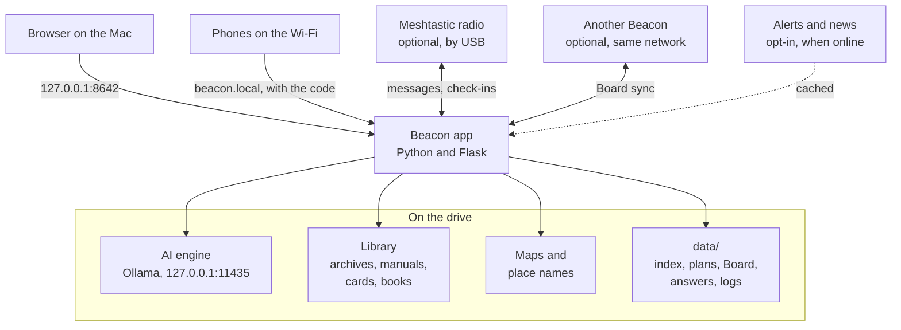
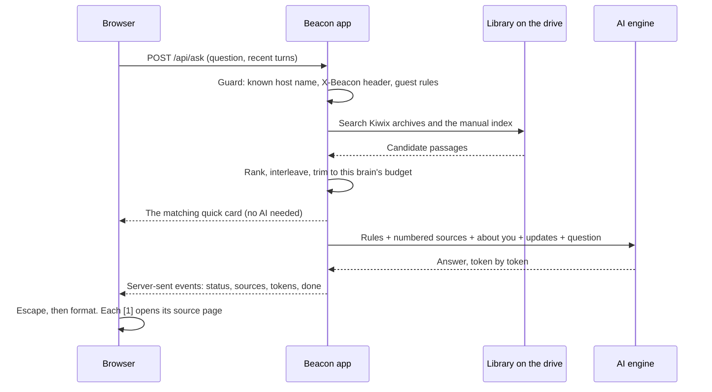
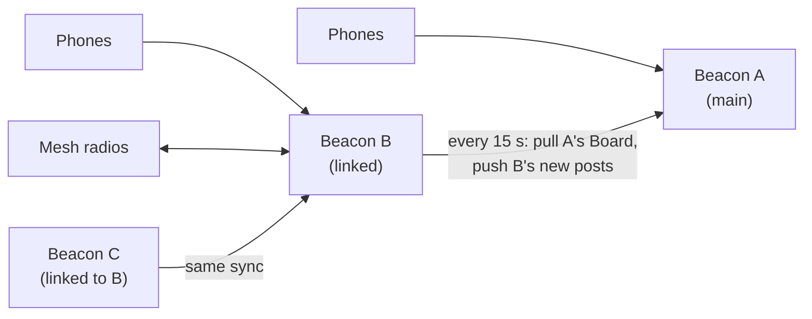

# How Beacon works

Beacon is one small Python program on a USB drive. It serves a web page to the browser on the Mac it's plugged into, answers questions with an AI engine that also runs from the drive, and reads a library that sits beside it. Phones on the same Wi-Fi can use the same page. Nothing in the design needs the internet: downloads, alerts and news are extras for when it's there.

This page explains the pieces, what happens on a question, where data lives, and how to extend Beacon. [SECURITY.md](../SECURITY.md) covers the threat model and controls in depth.

## The pieces



| Piece | What it is | Where |
|---|---|---|
| The app | A Flask web server and API. Every request passes one guard: host-name allowlist, a required header on anything that changes state, and guest permissions. | [`beacon/app.py`](../beacon/app.py) |
| The interface | Plain HTML, CSS and JavaScript with no build step and nothing loaded from the internet. Six tabs (Home, Plan, Map, Board, Tools, Library), sheets for settings and setup, and the emergency overlay. | [`static/`](../static) |
| The AI engine | Ollama, started by the launcher on its own port with its models on the drive. Beacon picks the strongest model the Mac's memory can run. | [`scripts/launch.sh`](../scripts/launch.sh), [`beacon/models.py`](../beacon/models.py) |
| The library | Kiwix archives (Wikipedia, WikiMed, iFixit and more), PDFs and text manuals, the quick cards, and the reading shelf. Everything is downloaded from its publisher and checked. | [`catalog.json`](../catalog.json), [`beacon/library.py`](../beacon/library.py) |
| Retrieval | Full-text search inside the Kiwix archives, plus Beacon's own index of manuals (embeddings and keywords, in SQLite). | [`beacon/kiwix_source.py`](../beacon/kiwix_source.py), [`beacon/manuals.py`](../beacon/manuals.py), [`beacon/rag.py`](../beacon/rag.py) |
| Maps | Place search over GeoNames, distance and heading math, and PMTiles maps drawn by MapLibre in the browser. | [`beacon/places.py`](../beacon/places.py), [`beacon/mapdata.py`](../beacon/mapdata.py), [`static/js/map.js`](../static/js/map.js) |

## What happens when you ask



1. **Guard.** The request must use a host name Beacon answers to (`localhost`, an IP address or a `.local` name), carry `X-Beacon: 1`, and, from a phone, a valid session.
2. **Quick card.** Keywords in the question pick the matching card ([`beacon/cards.py`](../beacon/cards.py)), which is offered above the answer at once. It works even when the AI is off.
3. **Retrieval.** The question is rewritten into a few search variants. Kiwix archives are searched by full text; your manuals by meaning and keywords. Results from both are interleaved so neither crowds out the other, then trimmed to what this Mac's brain can read: 4 sources on 8 GB, up to 12 on a large workstation ([`PROFILES`](../beacon/models.py)).
4. **Prompt.** Short rules (cite sources, lead with the action, be conservative on medical and safety questions, never confirm a wild plant is safe from a description), the numbered sources, and two optional notes: **About the person asking** (from the setup answers) and **Current updates** (dated, and marked as possibly out of date).
5. **Answer.** Ollama streams tokens; Beacon relays them as server-sent events. The browser escapes everything before applying Markdown, so nothing in a source or an answer can run as code.

Plans work the same way, with a template's fields ([`beacon/plans.py`](../beacon/plans.py)), your household info and the phase (preparing ahead, happening now, recovering after) shaping the search and the prompt. Every plan made on the Beacon computer is saved to the drive and can be downloaded as a PDF made by Beacon itself ([`beacon/pdf.py`](../beacon/pdf.py)), with no print dialog and no internet.

## Your next steps

The setup questions ask when this is for, what you're facing, who's with you, where you are, and what you have, from "almost nothing yet" to a power station and radios. [`beacon/situation.py`](../beacon/situation.py) turns the answers into next steps with plain rules, no AI:

- **Do first**: three to five actions for the moment you're in, each with a button that opens the right card, plan or tool.
- **What you have**: what each thing is good for, and how to use it safely.
- **What's missing**: in order of importance, each with a way to make do until you have it. Typing "CPAP" or "insulin" under special needs changes the advice.
- **Plans, quick cards and library items** that fit, with the most specific threat first.

Rules instead of the AI, on purpose: the steps appear instantly, work with the AI off, are the same every time, and are covered by tests. The same answers then travel to the AI as a short note, so answers fit the person asking.

Privacy follows who's asking. The Beacon computer's answers are saved on the drive (`data/situation.json`) and never shown to guests. A guest's answers stay in their phone's browser storage and ride along with each of their questions; Beacon never stores them.

## Sharing with phones

Turning on **Share** starts a second server on the local network: port 80 if the Mac allows it, so people can type just `beacon.local`, otherwise 8643. Bonjour advertises the name; if another Beacon already uses `beacon.local`, this one picks a unique name.

A guest enters the 4-digit code once and gets a random 192-bit session cookie. Guests can ask, plan, read, use the tools, check in and save files to their phone. Everything that changes the Beacon computer (downloads, settings, household info, links, updates, quitting) is refused for guests in one place, the `GUEST_BLOCKED` list in the guard. Every sign-in, wrong code and blocked request lands in the connections monitor ([`beacon/audit.py`](../beacon/audit.py)).

## The Board, mesh radios and linked Beacons

The Board ([`beacon/board.py`](../beacon/board.py)) is one list of check-ins and posts. Each post records where it came from (this Beacon, a phone, a mesh radio, or a linked Beacon) and an **origin**: the ID of the Beacon it started on plus its own ID. Origins are how posts travel without looping or doubling.



- **Mesh radios** ([`beacon/mesh.py`](../beacon/mesh.py)). With the optional Meshtastic add-on, a radio plugged into the Mac connects by itself. Text heard over the air becomes posts; `SAFE name` and `HELP name: details` become check-ins; posts can go out over the air. A radio with GPS gives the Mac its location for the Map and the radio tool.
- **Linked Beacons** ([`beacon/links.py`](../beacon/links.py)). A second Beacon links to a main one with the main one's code, exactly like a phone joins, so it gets the same guest permissions and shows up in Connections, where the main Beacon can sign it out. Every 15 seconds it pulls the main Board and pushes its own new posts. Links can form a star or a chain; origins stop echoes. Nothing else crosses a link: no household info, setup answers, saved plans or settings.
- **Radio help** without the add-on: Tools > Radio channels lists walkie-talkie, CB, marine, ham and weather channels, and builds a MAYDAY or PAN-PAN call from your details.

Links work on the local network only. Linking Beacons across the internet is planned (see below), because it needs end-to-end encryption first.

## Updates when online

Off by default. When the person running Beacon turns updates on and the Mac has internet, [`beacon/updates.py`](../beacon/updates.py) checks the feeds listed in `catalog.json` at most every 30 minutes: National Weather Service alerts for the setup's place (US only), GDACS disaster alerts, USGS significant earthquakes, US State Department travel advisories, and two news headline feeds. Each answer is size-capped, parsed as data (XML with document type declarations is refused), stripped to plain text, and cached in `data/updates.json`, so phones and the AI can read the latest copy offline. Local warnings show as a banner on Home.

What leaves the Mac: one request to each feed. The weather service also gets the place's coordinates, rounded to about a kilometer. Nothing about the person, their questions or their answers is sent.

## A brain that fits the machine

[`beacon/models.py`](../beacon/models.py) lists brains from strongest to lightest with the memory each needs. At startup Beacon reads the Mac's memory, graphics and battery, uses the strongest installed brain that fits, and sizes the reading budget to match. Low power mode stops the AI engine; cards, tools, maps, the Board and the library keep working, because none of them need it.

## Data on the drive

| Path | What's in it | Who can see it |
|---|---|---|
| `library/zim/` | Kiwix archives | Everyone on this Beacon |
| `library/manuals/` | PDFs, text, your own documents; `cards/` holds the quick cards | Everyone on this Beacon |
| `library/books/` | The reading shelf | Everyone on this Beacon |
| `maps/` | Map files and place names | Everyone on this Beacon |
| `models/` | AI brains | The Beacon computer |
| `data/manuals_index.sqlite` | The search index for manuals | The Beacon computer |
| `data/household.json` | Your household | The Beacon computer only |
| `data/situation.json` | The Beacon computer's setup answers | The Beacon computer only |
| `data/supplies.json` | The supplies list | The Beacon computer only |
| `data/archive/` | Saved plans and answers | The Beacon computer; guests see shared ones |
| `data/board.json` | The Board | Everyone on this Beacon and linked Beacons |
| `data/node.json` | This Beacon's random ID and name | Linked Beacons see the name |
| `data/links.json` | Linked Beacons and their sessions | The Beacon computer only |
| `data/updates.json` | Cached alerts and headlines | Everyone on this Beacon |
| `data/logs/` | Security log and engine log | The Beacon computer only |
| `data/SBOM.txt` | Every program on the drive, with versions and hashes | Anyone with the drive |

Browsers keep only small preferences (theme, text size, units, the name used on the Board). A guest's setup answers also stay in their own browser.

## Extending Beacon

Most of Beacon is data, so most extensions are one entry in one file, plus a test.

| To add | Do this |
|---|---|
| A quick card | Write `library/manuals/cards/your-card.md` (a `# Title Card` heading, short sections, a `Sources:` line). Add one line to `CARDS` in [`beacon/cards.py`](../beacon/cards.py) for its tab name, and one to `KEYWORDS` so questions find it. Unlisted cards still appear, at the end. |
| A plan | Add a template to `TEMPLATES` in [`beacon/plans.py`](../beacon/plans.py): an ID, a title, the fields to ask, the sections the plan must cover, and the words to search the library for. Give it an icon in [`static/js/plan.js`](../static/js/plan.js). |
| A tool | Write a function that draws into an element and add it to `TOOLS` in [`static/js/tools.js`](../static/js/tools.js), with its group, icon and one-line description. Mark it `host: true` if guests shouldn't use it. |
| A library item or topic | Add it to a band in [`catalog.json`](../catalog.json) with its tier, URL, license and, where the publisher offers one, a checksum. The Library tab, the installer and the health check pick it up. |
| An update feed | Add an entry under `updates` in `catalog.json`: an ID, a title, `nws`, `usgs` or `rss`, a scope (local, world or news) and a URL. Feeds in another format need a parser in `PARSERS` in [`beacon/updates.py`](../beacon/updates.py). |
| A brain | Add a tier to `TIERS` in [`beacon/models.py`](../beacon/models.py) with the memory it needs. The builder and the Library tab read the same list. |
| A setup question or answer | Add it to the lists at the top of [`beacon/situation.py`](../beacon/situation.py), then teach `assess` what it changes. The interface draws the questions from the server, so there's nothing to change there. |

Run `python -m pytest -q` after any change. The tests fake the AI engine, the internet, Bonjour and the radio, so they run anywhere in seconds.

## Code map

```
beacon/
  app.py          web server, API and the request guard
  share.py        Wi-Fi sharing: codes, sessions, Bonjour names
  audit.py        connections monitor and security log
  situation.py    setup questions and Your next steps
  rag.py          retrieval, prompts and streaming answers
  cards.py        quick cards: tab order, names, keywords
  plans.py        plan templates
  archive.py      saved plans and answers
  pdf.py          dependency-free PDF writer
  board.py        check-ins and posts
  links.py        linked Beacons on the same network
  mesh.py         Meshtastic bridge (optional add-on)
  updates.py      alerts and headlines, when online and turned on
  library.py      catalog, Kiwix catalog, verified downloads
  kiwix_source.py offline encyclopedias
  manuals.py      index of PDFs and text (embeddings and keywords)
  places.py       place search and navigation math
  mapdata.py      place names and map building
  models.py       brain tiers and reading budgets
  checks.py       health check and security self-test
  system.py       hardware, battery and drive checks
  installer.py    command-line installer used by the builder
static/           index.html, beacon.css, js/ (one file per tab), vendor/ (bundled map and QR libraries)
scripts/          build_usb.sh, launch.sh, the Beacon app, hash-locked requirements
tests/            one suite; the AI engine, internet, Bonjour and radio are faked
```

## Principles

- **Works with the AI off.** Cards, tools, maps, the Board, saved plans and the library never wait on the AI.
- **Shows its work.** Every answer cites the page it came from, and the card for the situation is one tap away.
- **Rules where safety matters.** Next steps, card matching and check-in parsing are deterministic and tested.
- **Nothing leaves the Mac unless someone asks.** Sharing, downloads and updates are each turned on by a person, and each says what it sends.
- **Plain words.** Interface text is written for someone who's scared, tired or reading by flashlight.

## What's next

- **Beacons across the internet.** When there is internet, Beacons could find each other and exchange short-lived messages, end-to-end encrypted, visible only to Beacons that choose to be found. The local link protocol already carries origins and names; what's missing is identity keys, encryption and a relay. Reticulum (with LXMF messaging) and Nostr are the two candidates: Reticulum also runs over LoRa radios, which fits the mesh; Nostr relays are easy to reach from anywhere. Either way the rule stays the same: off by default, and nothing personal leaves without a person choosing it.
- Offline turn-by-turn routing for the home region.
- Optional HTTPS on the local network with a locally installed certificate.
- Text recognition (OCR) for scanned PDFs.
- Real-radio testing for the Meshtastic bridge.
